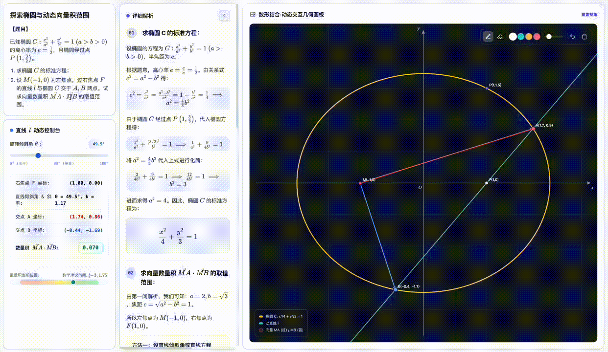

# edulab

**English** · [Türkçe](../edulab-tr/README.md) · [简体中文](https://github.com/wy51ai/edulab/blob/master/README.zh-CN.md)

> **Localization note**: This is an English-localized version of the original [wy51ai/edulab](https://github.com/wy51ai/edulab). Skill descriptions, trigger words, and workflow instructions have been translated. Core computation kernels, templates, and media are unchanged.

A collection of education skills that turn academic problems into **interactive lesson web pages** and **narrated explainer videos**.

## How to use

1. **Install the skills** (choose one):
   ```bash
   npx skills add msaran1923/edulab-en
   ```
   Or as a Claude Code plugin:
   ```
   /plugin marketplace add msaran1923/edulab-en
   /plugin install edulab
   ```

2. **Trigger a skill** by describing what you want in English, for example:
   - “Create an interactive solid geometry page for this cube problem”
   - “Make an analytic geometry solution page for this ellipse chord length problem”
   - “Turn this math problem into an explainer video”

3. **The agent follows the skill workflow**: it solves with the exact sympy kernel, assembles a self-contained HTML page (or video), and delivers the result in your current directory.

4. **For videos**: set `TTS_ENGINE=edge` (or leave as `auto`) to use edge-tts English voices instead of the original Chinese GLM-TTS.

## Install

**Recommended** — install with [skills](https://github.com/vercel-labs/skills) in one command:

```bash
npx skills add msaran1923/edulab-en
```

To update to the latest version later:

```bash
npx skills update
```

> **Note:** `npx skills update` only refreshes skills you've **already** installed — it does **not** pull in skills newly added to the repo. When this repo gains a new skill (e.g. a new `edu-*`), run `npx skills add msaran1923/edulab-en` again to install it.

Or use it as a Claude Code plugin marketplace:

```
/plugin marketplace add msaran1923/edulab-en
/plugin install edulab
```

Once installed, the skills activate on their trigger words, and can also be invoked manually.

## Skill: edu-solid-geometry


Solves one solid geometry problem into a self-contained interactive lesson page. Three entry points:

| Entry point | What it does |
|---|---|
| Text problem | Extracts the statement and solves directly |
| Image upload | Reads the problem from the image via vision, echoes it back for confirmation, then solves |
| Random problem | Solves with random parameters; re-rolls if the answer isn't clean |

**Problem types covered**: line-plane angle, dihedral angle, angle between skew lines, point-to-plane distance, volume, and more — on cubes / cuboids, pyramids / prisms, cylinders / cones. All solved uniformly via the "coordinate system + vector method."

**Trigger words**: solid geometry, line-plane angle, dihedral angle, angle between skew lines, distance to plane, interactive geometry solution page.

### Dependency

The compute core `lib/geometry_kernel.py` depends on **sympy**. Use any `python3` that can import sympy:

```bash
python3 -m pip install sympy   # if sympy is missing
```

### Generate from the command line (without Claude)

```bash
cd skills/edu-solid-geometry
python3 scripts/generate.py cube   ./cube.html     # cube · line-plane angle
python3 scripts/generate.py box    ./box.html      # cuboid · volume
python3 scripts/generate.py random 7 ./random.html # random problem (seed=7)
python3 lib/geometry_kernel.py                     # kernel built-in self-check
```

> If you don't pass an output path, it writes to the **current working directory (cwd)**.

## Skill: edu-analytic-geometry



Solves one analytic geometry (conic sections) problem into a self-contained interactive lesson page. Same three entry points as above (text / image / random). Built on a **2D Canvas board + KaTeX** with a generic, data-driven interactive engine: a parameter slider drives derived constructions (line∩conic, point-on-conic, central reflection, tangent…) and live readouts, with a theoretical-range bar or a fixed-value indicator.

**Problem types covered**: standard equation, chord length, dot-product range / fixed value, triangle-area extremum, fixed point, fixed value (slope product), locus, tangent, eccentricity — on ellipses / hyperbolas / parabolas / circles. All solved uniformly via "parametrized line `x = my + c` + system + Vieta's formulas + substitution."

**Trigger words**: analytic geometry, conic sections, ellipse, hyperbola, parabola, chord length, dot product range, fixed point, fixed value, locus, eccentricity, interactive analytic geometry solution page.

### Dependency

The compute core `lib/analytic_kernel.py` depends on **sympy** (same as above).

### Generate from the command line (without Claude)

```bash
cd skills/edu-analytic-geometry
python3 scripts/generate.py list                          # list registered problem types
python3 scripts/generate.py ellipse_dot_range ./sol.html  # ellipse · MA·MB range [-3, 7/4]
python3 scripts/generate.py parabola_dot_const ./sol.html # parabola focal chord · OA·OB ≡ -3
python3 scripts/generate.py all ./out_dir                 # all registered types
python3 lib/analytic_kernel.py                            # kernel built-in self-check
```

> Like above, no output path → writes to the **current working directory (cwd)**.

## Skill: edu-chem-reaction

Turns one chemical reaction into a self-contained **microscopic 3D demonstration** page: an interactive Three.js molecular animation (drag the slider to watch bonds break / form and atoms recombine, with step highlighting) next to the KaTeX equation, step-by-step narration, an atom-conservation counter, and an optional energy–reaction-coordinate curve. Same three entry points (text / image / random).

**Trigger words**: chemistry reaction, microscopic / molecular animation, combustion, electrolysis, redox electron transfer, esterification mechanism, bond breaking and forming, atom conservation, balance equation, interactive chemistry reaction page.

## Skill: edu-math-video

Turns one math problem (geometry, algebra, functions, motion problems…) into a **16:9 1920×1080 explainer MP4**: English voice-over (edge-tts or compatible TTS), bilingual en + tr subtitles (`.srt` too), and hand-drawn notebook-style canvas animation driven by the narration timeline. Input is a problem screenshot or plain text.

**Note**: Original Chinese GLM-TTS can be replaced with `TTS_ENGINE=edge` for English voices.

**Trigger words**: math explainer video, walkthrough video, problem-solving video, micro-lesson.

## Skill: edu-physics-video and edu-chem-video

Similar video pipelines for physics and chemistry problems. Same TTS adaptations apply.

## How it works

1. **Get a problem spec** — normalize all three entry points into a structured description (body type and dimensions, given conditions, the quantity asked, language).
2. **Exact kernel computation** — sympy computes exact coordinates, key vectors, normals, the final answer, and every intermediate value (as LaTeX strings). Never by hand.
3. **Assemble and inject the template** — feed the `lesson` / `steps` / `model` data into the data-driven template; 3D vertex coordinates come from `kernel.to_three(...)`, sharing the same source as the solution.
4. **Self-check** — kernel answer == answer card == final value shown in the last step; a local static server + preview check confirms no console errors and correct formula/highlight rendering.
5. **Deliver** — the finished page is written to the user's current working directory, named like `solution-<short-description>.html`.

## License

Apache-2.0

Original project: https://github.com/wy51ai/edulab
